<!-- ##{"timestamp":1498702839,"style":"<style>p span{filter:blur(3px);background:rgba(200,200,200,0.3);color:rgba(0,0,0,0.5);cursor:pointer;transition:0.3s;padding:2px 5px;border-radius:4px}p span:hover{filter:blur(0);background:transparent;color:inherit}</style>"}## -->
# Markdown 渲染测试

本文件用于检查本站 Markdown 预览效果（markdown-it · Prism · KaTeX · Mermaid · medium-zoom）。  
**只展示渲染结果**，不含语法教学代码。若某段仍显示为源码，说明当前环境未启用该能力。

---

## 1. 标题

正文里用 H4–H6 做实渲染（避免再出现多个一级标题打乱大纲）。H1 即本文标题；H2/H3 见各章节。

#### 四级标题
##### 五级标题
###### 六级标题

Setext 样式（若引擎支持）：

小标题（Setext 二级）
-----------

---

## 2. 段落与换行

这是第一段。段落之间空一行。

这是第二段。  
上一行末尾两个空格，本行应硬换行续写。

本站开启了 `breaks`：单回车也会换行  
像这样。

---

## 3. 强调与行内

- **粗体（星号）**
- __粗体（下划线）__
- *斜体（星号）*
- _斜体（下划线）_
- ***粗斜体***
- `行内代码`
- 混合：**粗体**、*斜体*、`code`
- ~~删除线~~
- ==高亮标记==
- 上标：x^2^、2^10^
- 下标：H~2~O、CO~2~

---

## 4. 列表

无序：

- 苹果
- 香蕉
  - 芭蕉
  - 大蕉
- 橙子

有序：

1. 第一步
2. 第二步
   1. 子步骤 A
   2. 子步骤 B
3. 第三步

任务列表：

- [x] 已完成
- [ ] 未完成
- [ ] 另一项待办

---

## 5. 链接与图片

- [普通链接](https://example.com)
- [带标题的链接](https://example.com "Example")
- [邮箱链接](mailto:test@example.com)
- 自动链接：https://example.com
- 尖括号链接：<https://example.com>
- 引用式链接：[GitHub][ref-github]

[ref-github]: https://github.com

普通图片：


引用式图片：

![引用式图片][ref-img]

[ref-img]: https://placehold.co/200x80/png?text=Ref+Image "引用式图片"

---

## 6. 引用块

> 第一段引用。
>
> 第二段引用。
>
> > 嵌套引用。

---

## 7. 代码块与语法高亮

行内：`const x = 1`

```javascript
function greet(name) {
  return `Hello, ${name}!`;
}

console.log(greet("Markdown"));
```

```python
def add(a, b):
    return a + b

print(add(1, 2))
```

```ts
type User = { id: number; name: string };

export function hello(user: User): string {
  return `Hi, ${user.name}`;
}
```

```
plain text
line 2
```

缩进代码块（行首 4 空格）：

    function indentedBlock() {
      return true;
    }

---

## 8. 分割线与转义

上方

---

中间

***

下方

___

转义后应显示为字面量（不是标题 / 斜体 / 代码 / 链接）：

\# 这不是标题

\*不是斜体\*

\`不是代码\`

\\ 反斜杠本身

\[链接](url) 不变成链接

---

## 9. 表格

| 左对齐 | 居中 | 右对齐 | 说明 |
| :----- | :--: | -----: | ---- |
| A | B | 1 | 文本 |
| 较长内容 | 中 | 999 | 数字 |
| `code` | **粗** | *斜* | 混合 |

表格内常见写法：

| 功能 | 详情 |
|------|------|
| 代码 | `inline` 代码 |
| 链接 | [Example](https://example.com) |
| 强调 | **粗** / *斜* / ~~删~~ |

---

## 10. 脚注与表情

标准脚注：这里有一个引用[^1]。  
命名脚注：另见说明[^note]。

[^1]: 数字脚注内容。
[^note]: 命名脚注内容。

表情简码：:rocket: :white_check_mark: :warning: :smile: :thumbsup:

原生 Emoji：😊 🚀 ✅ ⚠️ 💻 🌍

---

## 11. 数学公式（KaTeX）

### 11.1 行内与块级

行内：$E=mc^2$，欧拉公式 $e^{i\pi}+1=0$，勾股 $a^2+b^2=c^2$。

块级：

$$
\int_0^1 x^2 \, dx = \frac{1}{3}
$$

$$
A=\pi r^2
$$

### 11.2 分式、求和、积分、希腊字母

分数 $\frac{a}{b}$，根号 $\sqrt{a^2+b^2}$，求和 $\sum_{i=1}^{n} i$，希腊字母 $\alpha,\beta,\gamma,\Delta,\Omega$。

$$
\sum_{n=1}^{\infty}\frac{1}{n^2}=\frac{\pi^2}{6},\quad \int_{-\infty}^{+\infty}e^{-x^2}\,dx=\sqrt{\pi}
$$

### 11.3 矩阵、对齐、分段、方程组

$$
\begin{pmatrix}
1 & 2 \\
3 & 4
\end{pmatrix}
$$

$$
\begin{aligned}
y &= 2x + 1 \\
&= 2(x+0.5)
\end{aligned}
$$

$$
f(x)=
\begin{cases}
1, & x>0 \\
0, & x\le 0
\end{cases}
$$

$$
\left\{
\begin{aligned}
x+y &= 3 \\
x-y &= 1
\end{aligned}
\right.
$$

$$
\underbrace{a+b+c}_{S}
$$

### 11.4 常见公式摘录

- 求根公式：$x = \frac{-b \pm \sqrt{b^2 - 4ac}}{2a}$
- 极限：$\lim_{x \to 0} \frac{\sin x}{x} = 1$
- 正态分布：$f(x) = \frac{1}{\sqrt{2\pi}\sigma} e^{-\frac{(x - \mu)^2}{2\sigma^2}}$
- 麦克斯韦方程组：

$$
\begin{array}{c}
\nabla \times \vec{\mathbf{B}} -\, \frac{1}{c}\, \frac{\partial\vec{\mathbf{E}}}{\partial t} = \frac{4\pi}{c}\vec{\mathbf{j}} \\
\nabla \cdot \vec{\mathbf{E}} = 4 \pi \rho \\
\nabla \times \vec{\mathbf{E}}\, +\, \frac{1}{c}\, \frac{\partial\vec{\mathbf{B}}}{\partial t} = \vec{\mathbf{0}} \\
\nabla \cdot \vec{\mathbf{B}} = 0
\end{array}
$$

也可用围栏写法：

```math
\frac{d}{dx}\left( \int_{0}^{x} f(t)\,dt \right) = f(x)
```

---

## 12. Mermaid 图表

### 12.1 流程图

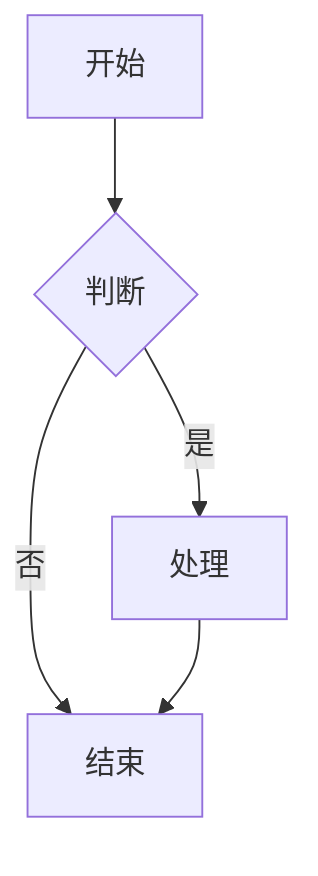

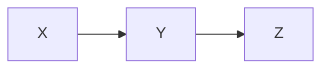

### 12.2 时序图

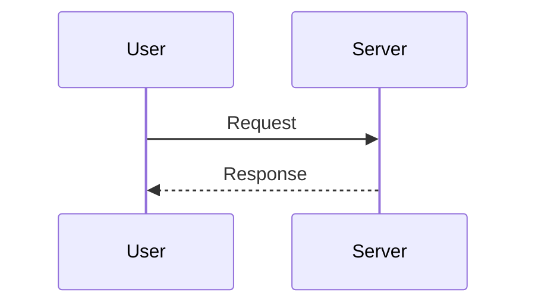

### 12.3 类图

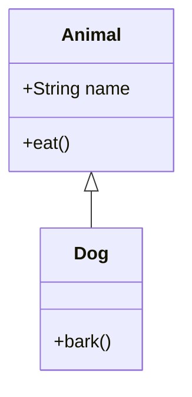

### 12.4 状态图

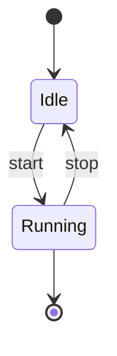

### 12.5 ER 图

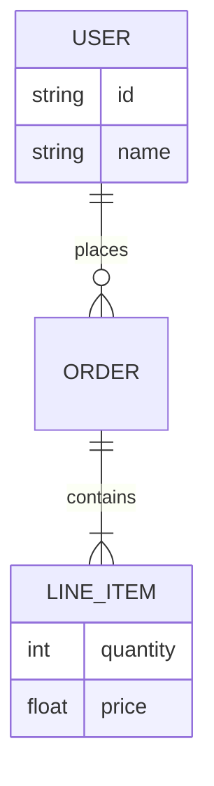

### 12.6 甘特图

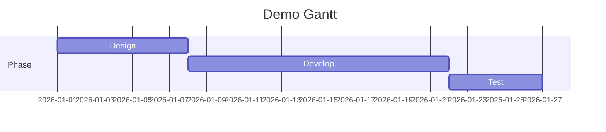

### 12.7 饼图

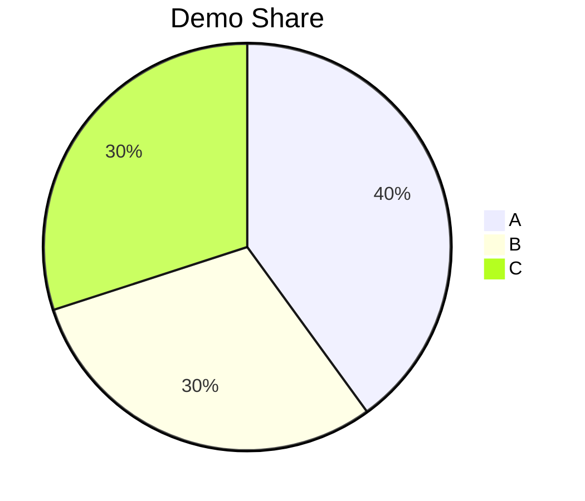

### 12.8 思维导图

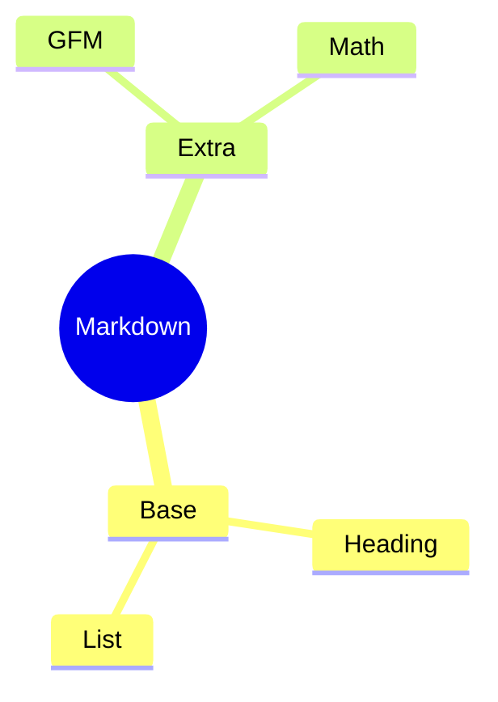

### 12.9 Git 分支图

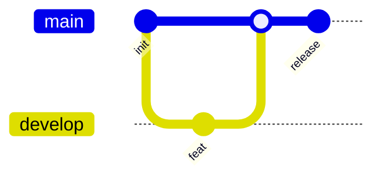

### 12.10 时间线

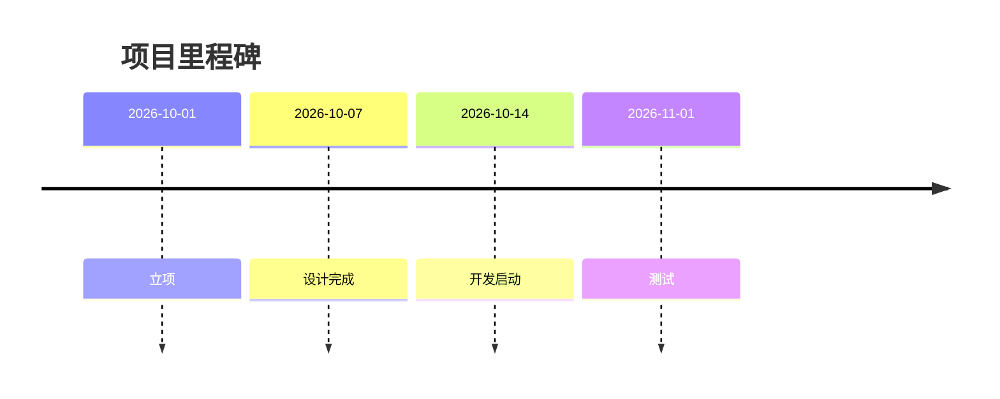

---

## 13. 图片灯箱（medium-zoom）

点击图片应出现半透明遮罩、图片居中放大。链接包裹的图、代码块里的图一般不应进灯箱。

### 13.1 竖图


### 13.2 多图（批量绑定）


### 13.3 链接包裹（点击易跳转而非灯箱）

[](https://placehold.co/800x500/png?text=Target)

### 13.4 行内图

这是一段文字，里面放一张图  然后继续文字。

### 13.5 代码块里的图片语法（不应触发灯箱）

```markdown

```

---

## 14. 字符与多语言（精简）

### 14.1 ASCII 与易混标点

`A-Z` `a-z` `0-9`  
`! " # $ % & ' ( ) * + , - . / : ; < = > ? @ [ \ ] ^ _ \` { | } ~`

全角 vs 半角：，, 。. ；; ：: ！! ？? （）() 【】[]

### 14.2 中日韩与其它文字

- 简体：学而时习之，不亦说乎？
- 繁体：學而時習之，不亦說乎？
- 生僻字：龘 靇 齉 䶮
- 日文：あいうえお / アイウエオ / 今日は天気が良いです。
- 韩文：안녕하세요 감사합니다
- 俄语：Привет, мир!
- 阿拉伯语（RTL）：السلام عليكم
- 泰语：สวัสดีครับ

### 14.3 符号与排版

数学：± × ÷ √ ∞ ∑ ∫ ≈ ≠ ≤ ≥  
货币：¥ $ € £ ₩ ₹  
单位：℃ ℉ ㎞ ㎏ ㎡  
箭头：← ↑ → ↓ ↔  
图形：■ □ ★ ☆ ● ○

上下标字符：X¹ X² X³ X₁ X₂ X₃  
超长无空格（测换行）：aaaaaaaaaaaaaaaaaaaaaaaaaaaaaaaaaaaaaaaaaaaaaaaaaaaaaaaaaaaaaaaaaaaaaaaaaaaaaa  
混合：123!@#あいう안녕😊💻

---

## 15. 本站未开启或通常无效（对照）

下列写法多数预览器会原样显示或忽略，放在这里方便对照，**不是写错**：

> [!NOTE]
> GitHub Alert：本站未内置，多半当普通引用。

Front Matter / TOC / HTML（本站 `html: false`，标签不会当 HTML 执行）：

```text
---
title: demo
---

[TOC]

<u>下划线</u>
<details><summary>折叠</summary>内容</details>
```

PlantUML / Graphviz / Vega 等非 Mermaid 图表：本站只渲染 `mermaid` 围栏，其它语言会当普通代码块。
